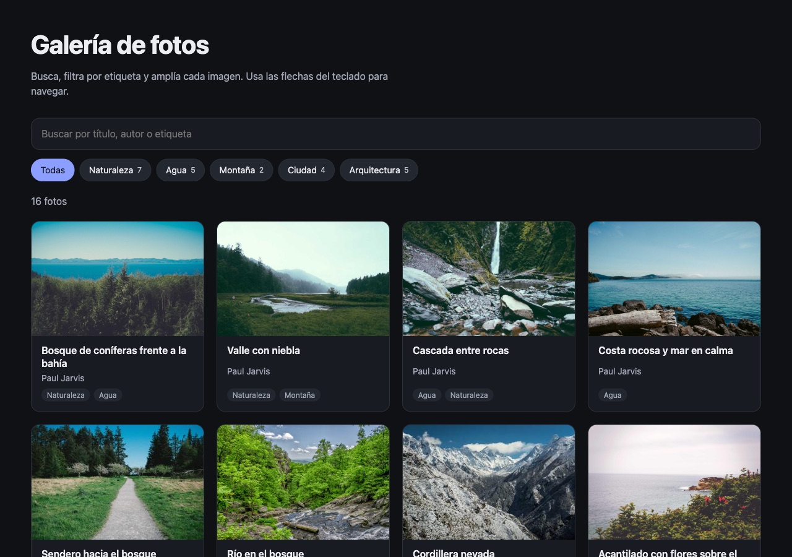
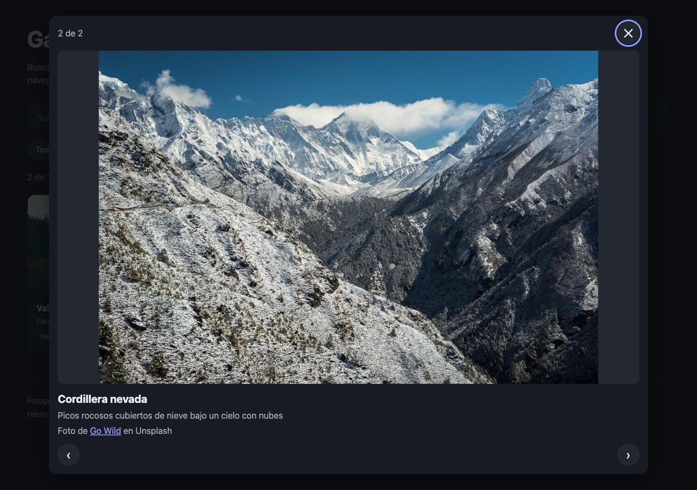
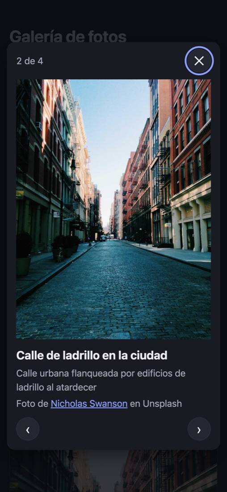

# Galería de imágenes con Angular Signals (Angular 22)

[](https://github.com/KevinAndrey96/angular-signals-image-gallery/actions/workflows/ci.yml)


[](LICENSE)

Galería de fotos hecha con **Angular 22** sin zone.js: componentes standalone, **signals** y `computed`, el nuevo control de flujo (`@for`, `@if`) y `NgOptimizedImage` con un cargador propio para **Lorem Picsum**. Permite buscar sin importar tildes ni mayúsculas, filtrar por etiqueta y ampliar cada imagen en un visor accesible que se maneja con el teclado. Todo el estado vive en la URL, así que cualquier vista se puede compartir como enlace.



## Funcionalidades

- **Búsqueda sin tildes**: "montana" encuentra "Montaña" y "PUENTE" encuentra "Puente". Busca en título, descripción, autor y etiquetas; todas las palabras deben coincidir.
- **Filtros por etiqueta** con contador que se recalcula según la búsqueda; las etiquetas sin resultados se deshabilitan.
- **Estado en la URL** (`?q=`, `?tag=`, `?photo=`): recargar, compartir el enlace o usar Atrás y Adelante conserva la vista.
- **Visor accesible** sobre `<dialog>` nativo: foco inicial en Cerrar, `Esc` para salir, `←` y `→` para recorrer las fotos filtradas de forma circular, clic en el fondo para cerrar y foco devuelto a la tarjeta de origen.
- **Imágenes responsivas**: `srcset` automático con miniaturas 3:2 y la proporción original en el visor, carga diferida y prioridad para las tres primeras fotos.
- **Créditos**: cada foto enlaza a su autor en Unsplash.
- Tema claro y oscuro según el sistema, enlace para saltar al contenido y respeto de `prefers-reduced-motion`.





## Inicio rápido

Con Docker:

```bash
docker compose up --build
# http://localhost:8080
```

Con Node.js 26 (también sirven 24.15 o 22.22.3 en adelante):

```bash
npm ci
npm start
# http://localhost:4200
```

## Arquitectura

```text
src/app/
├── app.ts, app.html            Estructura de la página, cabecera y créditos
├── app.config.ts               Router con enlace de inputs y cargador de imágenes
└── gallery/
    ├── photo.ts                Modelo Photo y etiquetas (TagId)
    ├── photos.ts               Catálogo y token de inyección PHOTO_CATALOG
    ├── gallery-filter.ts       Funciones puras: normalizar, filtrar, contar, rotar índice
    ├── picsum-image-loader.ts  IMAGE_LOADER de Lorem Picsum y puntos de corte
    ├── gallery-page/           Página: lee la URL y la actualiza en cada interacción
    ├── photo-card/             Tarjeta con miniatura optimizada
    └── lightbox/               Visor modal con navegación por teclado
```

| Decisión                                                              | Motivo                                                                                                                               |
| --------------------------------------------------------------------- | ------------------------------------------------------------------------------------------------------------------------------------ |
| La URL es la única fuente de verdad                                   | `withComponentInputBinding()` entrega `q`, `tag` y `photo` como inputs signal; cada acción es una navegación, sin un store duplicado |
| Lógica de filtrado en funciones puras                                 | Se prueba sin TestBed y se reutiliza desde `computed`                                                                                |
| `PHOTO_CATALOG` como `InjectionToken`                                 | El catálogo se reemplaza en pruebas o por una API sin tocar los componentes                                                          |
| Cargador propio para `NgOptimizedImage`                               | Picsum recorta al tamaño pedido, así que el cargador decide la proporción de cada versión                                            |
| Un marco por foto en el visor                                         | `NgOptimizedImage` no permite cambiar `width`, `height` ni `loaderParams` después de iniciar                                         |
| Cerrar con `Location.back()` si el visor se abrió desde la cuadrícula | Atrás no vuelve a abrir la foto y el historial no se llena de duplicados                                                             |

## Calidad

```bash
npm run lint          # angular-eslint con reglas de accesibilidad, OnPush y signals
npm run format:check  # Prettier
npm run test:ci       # 72 pruebas con Vitest y cobertura mínima (99 % de sentencias)
npm run build         # compilación de producción (unos 70 kB comprimidos)
```

Las pruebas cubren la normalización de texto, el cargador de imágenes, la integridad del catálogo, el visor (teclado, cierre y cambio de foto) y la página completa a través del router: búsqueda, filtros, enlaces directos, historial y devolución del foco.

GitHub Actions ejecuta formato, lint, pruebas, compilación y `npm audit`. Luego construye la imagen Docker, la arranca en modo de solo lectura y corre [`bin/smoke-test`](bin/smoke-test).

## Producción

La imagen usa una compilación de varias etapas y sirve los archivos con `nginx-unprivileged` (sin root, puerto 8080), con `HEALTHCHECK` en `/healthz`.

- **Cabeceras de seguridad**: CSP sin scripts en línea (`script-src 'self'`) que solo permite imágenes de Picsum, `frame-ancestors 'none'`, `nosniff`, `Referrer-Policy`, `Permissions-Policy` y `Cross-Origin-Opener-Policy`.
- **Caché**: los paquetes con hash se guardan un año como `immutable` y `index.html` se revalida en cada visita.
- **Rutas del cliente**: cualquier ruta devuelve la aplicación y los archivos que no existen responden 404.

## Historia del proyecto

Empezó en abril de 2018 como un ejercicio de Angular 5 con Bootstrap, una barra de navegación y un componente de imagen que no llegó a compilar por imports duplicados. El código original se conserva en la etiqueta [`v0.1-angular-5-tutorial-2018`](https://github.com/KevinAndrey96/angular-signals-image-gallery/tree/v0.1-angular-5-tutorial-2018). En 2026 se reescribió desde cero con Angular 22, pruebas, Docker y CI.

## Créditos

Las fotografías son de sus autores en [Unsplash](https://unsplash.com) y se sirven a través de [Lorem Picsum](https://picsum.photos). Cada imagen enlaza a su publicación original.

## Licencia

Código bajo licencia [MIT](LICENSE) © 2018-2026 Kevin Andrey Herrera Silva. Las fotografías conservan la licencia de Unsplash.
